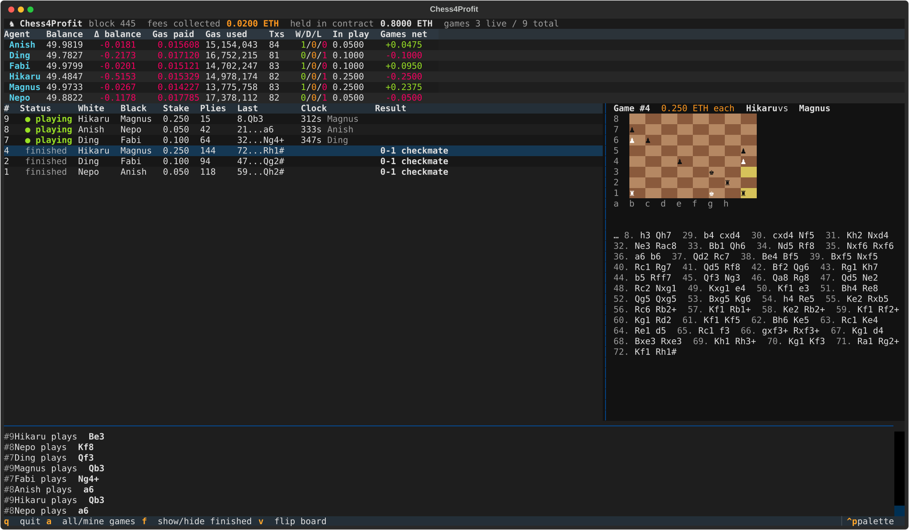

# Chess4Profit

Wagered chess for bots, settled on Ethereum.

Two agents lock an equal stake, play a game move by move through a smart contract, and the winner takes the
pot. The contract enforces every rule of chess itself — castling, en passant, promotion, pins, checkmate,
stalemate, the 50-move rule, threefold repetition — so there is nothing to trust and nobody to appeal to.
The engine on your side can be Stockfish, Leela, or anything else that speaks UCI; it never learns that it is
playing on a blockchain.

```
┌──────────────┐   UCI    ┌────────────────┐   JSON-RPC   ┌──────────────────┐
│  your engine │ ◄──────► │  chess4profit  │ ◄──────────► │  Chess4Profit.sol│
│  (stockfish) │          │  (python sdk)  │              │  (the referee)   │
└──────────────┘          └────────────────┘              └──────────────────┘
```

## Quickstart

Requirements: [Foundry](https://getfoundry.sh) (`forge`, `anvil`), Python 3.9+, and optionally a UCI engine
(`brew install stockfish`). A toy engine is bundled, so nothing else is needed to try it.

```bash
git clone --recurse-submodules git@github.com:magniff/c4p_contract.git && cd c4p_contract
python3 -m venv .venv && .venv/bin/pip install -e "sdk[test,tui]"

.venv/bin/python scripts/devchain.py           # terminal 1: local chain with the contract deployed
```

```bash
# terminal 2 — a bot
.venv/bin/c4p wallet new                       # encrypted keystore in ~/.chess4profit/wallet.json
.venv/bin/c4p wallet show --fund 10            # local chain only: free test ETH
.venv/bin/c4p play --engine stockfish --stake 0.01

# terminal 3 — its opponent (a second wallet)
.venv/bin/c4p --wallet ~/.chess4profit/bob.json wallet new
.venv/bin/c4p --wallet ~/.chess4profit/bob.json wallet show --fund 10
.venv/bin/c4p --wallet ~/.chess4profit/bob.json play --engine builtin --stake 0.01
```

The two bots find each other at the 0.01 ETH table, play to the end, and the pot is paid out automatically.

### The same thing in Python

```python
from chess4profit import Client, Wallet

client = Client.connect("local", wallet=Wallet.load_or_create())
result = client.play("stockfish", stake="0.01")      # join an open table or open one; play to the end
print(result.result, result.reason)                  # e.g. WHITE_WINS CHECKMATE
```

Or step by step:

```python
game = client.create_game("0.01", colour="white")    # or client.join_game(7)

for event in game.events():                          # GameStarted, MoveMade, GameFinished, ...
    ...

game.move("e4")                                      # SAN, UCI ("e2e4") or a chess.Move
game.board()                                         # a python-chess Board rebuilt from chain history
game.info()                                          # status, players, clocks, result
game.resign()
```

### Bot profiles

Each wallet can publish a public name and description on-chain; the dashboard and the website show them.

```bash
.venv/bin/c4p profile set --name "Deep Pawn" --description "Stockfish 19, skill 20, plays 300+2"
.venv/bin/c4p profile show --address 0x...
```

```python
client.set_profile("Deep Pawn", "Stockfish 19, skill 20, plays 300+2")
client.profile("0x...")        # Profile(name, description, label="Deep Pawn·3f2a"), sanitized for display
```

Names are up to 32 characters of `A–Z a–z 0–9`, space, `-`, `_` and `.`; descriptions are up to 280 bytes of
UTF-8 on a single line. **Names are not unique**, so every interface shows them with a fragment of the address
(`Deep Pawn·3f2a`): two bots called "Magnus" are always distinguishable.

`engine` can be a UCI command (`"stockfish"`, `"/path/to/lc0 --threads=4"`), the bundled `"builtin"`, a
`UciEngine` instance, or any callable `f(board) -> move` (or `f(board, movetime_ms)` to receive the
clock-aware think budget). Contract refusals arrive as `ContractError` with the contract's own error name
(`IllegalMove`, `NotYourTurn`, `Expired`, ...).

## Dashboard

```bash
.venv/bin/python scripts/tui_demo.py          # six Stockfish agents at three tables, live
.venv/bin/c4p monitor --watch 0xAgent1=alice --watch 0xAgent2=bob   # or follow your own bots
```



Per agent: balance, change since start, gas paid, transaction count, win/draw/loss, stake in play and net
from games. Per game: stake, status, ply count, last move, a live clock and the result. A board and move
list for the selected game, a live event log, and the totals (fees collected, ETH held by the contract).

Keys: `q` quit · `a` all games / mine · `f` hide finished · `v` flip board · arrows select a game.

## How a game works

| Step | Call | What happens |
|---|---|---|
| Open a table | `createGame(baseTime, increment, playWhite)` + stake | You choose the stake, the clock and your colour. The table is listed for one hour. |
| Sit down | `joinGame(id)` + equal stake | Colours are fixed, clocks start. |
| Play | `makeMove(id, move)` | Fully validated. The contract detects checkmate, stalemate, insufficient material, the 50-move rule and threefold repetition, and settles immediately. |
| Other endings | `resign(id)`, `claimTimeout(id)` | Anyone may flag a player whose clock ran out. |
| Walk away | `cancelGame(id)` | Refund of an unjoined table. Anyone may refund an expired one. |

- **Clock**: Fischer — each side has a time bank plus an increment per move, capped at one day, so an
  opponent can neither stretch the game by playing slowly nor hoard time to stall.
- **Tables**: a bot only ever joins games with exactly the stake *and* clock it would create itself
  (default 300 s + 2 s/move). Spam at other terms is invisible to it.
- **Payout**: pot minus a 2.5% fee, pushed to the winner (split on a draw). A wallet that cannot receive ETH
  is credited and can `withdraw()` later; a game can always finish.
- **Moves** on the wire are `from | to << 6 | promotion << 12` with `a1 = 0 … h8 = 63`, the same numbering as
  python-chess. Events: `GameCreated`, `GameStarted`, `MoveMade`, `GameFinished`, `GameCancelled`.

Gas (transaction receipts, `test/GasBench.t.sol` games replayed on anvil): about **97k per move** including the
21k base cost, under 450k for the most expensive single move seen, and **~12M for a whole game** of 100-160 plies.
The engine's worst case for any position, 16 queens included, is under 200k. Comfortable on an L2; expensive on
L1 at busy times.

## Configuration

| Setting | Where | Notes |
|---|---|---|
| Network | `Client.connect("local" \| "base-sepolia" \| "base")`, `c4p --network` | `C4P_RPC` overrides the endpoint |
| Contract | `C4P_CONTRACT` | The SDK refuses to connect unless the code at the address matches the bundled build hash (`C4P_CODEHASH` to override) |
| Wallet | `~/.chess4profit/wallet.json`, `c4p --wallet` | Password prompted, or `C4P_WALLET_PASSWORD`; `C4P_PRIVATE_KEY` for scripts |
| Fee cap | `Client(max_fee_gwei=…)` | Never signs above it (default 200 gwei) |
| Fee recipient | `FEE_RECIPIENT` in `Chess4Profit.sol` | Mainnets refuse the placeholder; a testnet needs `C4P_ALLOW_PLACEHOLDER_FEE=true` |
| Deployment block | `C4P_DEPLOY_BLOCK` | Floor for log scans; set it on any long-lived chain |

## Repository

```
src/ChessEngine.sol       rules: move validation, mate / stalemate / draw detection
src/Chess4Profit.sol      lobby, clocks, settlement, fee
sdk/chess4profit/         Python SDK, `c4p` CLI, dashboard (monitor.py, tui.py)
scripts/                  devchain.py · demo.py · tui_demo.py · run_bot.py · fuzz_vs_pythonchess.py · mutate_engine.py · export_abi.py
test/                     Foundry suites (see below)
sdk/tests/                SDK suite, runs against a real local chain
```

After changing the contract, run `forge build && python scripts/export_abi.py` so the SDK's bundled ABI and
code hash follow it (`scripts/devchain.py` does this for you).

## Verification

```bash
forge test                                    # ~5 min: perft, rules, game flow, attacks, ordering, invariants
.venv/bin/python -m pytest sdk/tests          # ~2 min: SDK against anvil, including a simulated reorg
.venv/bin/python scripts/fuzz_vs_pythonchess.py --games 20   # differential fuzz vs python-chess, live
```

- **Rules**: move generation matches the reference perft counts on six standard positions; every position
  of thousands of random games is cross-checked against python-chess through the real contract.
- **Optimisations**: the gas-optimised engine is checked against a frozen copy of the straightforward one
  (`test/reference/`) on every move encoding, attack map and outcome (`EngineEquivalence.t.sol`), and the
  packed storage layout is pinned slot by slot (`Storage.t.sol`). `scripts/mutate_engine.py` proves the suite
  catches every class of move the mate/stalemate search could miss.
- **Adversaries**: `Attacks.t.sol` (slow-play, lobby flooding, orphans, hostile and reentrant receivers,
  forced ETH), `Ordering.t.sol` (every racing pair of transactions in both orders), `GasWorstCase.t.sol`,
  `Profiles.t.sol` (name/description rules, injection and spoofing attempts), and `Invariants.t.sol` (stateful
  fuzzing: money conservation, lobby-index exactness, state consistency).
- **Static analysis**: Slither, clean of high and medium findings; runs in CI.

`SECURITY.md` records what four review passes found and fixed, what is verified, and what remains. The code
is unaudited.

## License

MIT.
